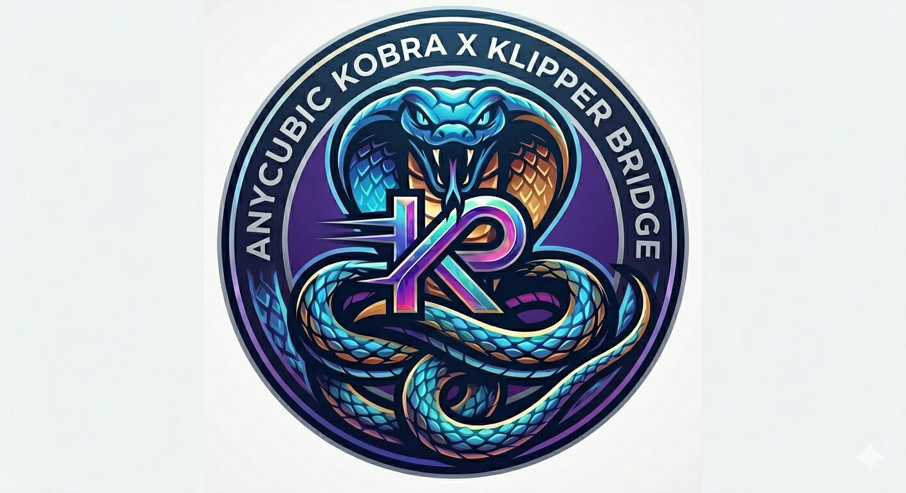

<div align="center">



# KX-Bridge

**Controla tu Anycubic Kobra X con OrcaSlicer — sin Klipper, sin Raspberry Pi.**

Un puente compatible con Moonraker que se comunica directamente con la impresora.

<sub>🇬🇧 <a href="README.md">English version</a>  ·  🇩🇪 <a href="README.de.md">Deutsche Version</a></sub>

<br>

[](https://ko-fi.com/viewitde)
&nbsp;
[](https://gitea.it-drui.de/viewit/KX-Bridge-Release/releases)
&nbsp;
[](https://gitea.it-drui.de/viewit/KX-Bridge-Release/releases)
&nbsp;
[](https://www.youtube.com/watch?v=1Ql4wfH27fM)

<sub>¿Te gusta KX-Bridge? Un café en <a href="https://ko-fi.com/viewitde">Ko-fi</a> mantiene el proyecto vivo. ☕</sub>

</div>

---

## ✨ Características

| | |
|---|---|
| 🖨️ | **Control de impresora** — iniciar, pausar, reanudar, cancelar, temperaturas, velocidad de impresión |
| 📊 | **Estado en tiempo real** — temperatura, progreso, capas, tiempo restante, transmisión de cámara |
| 🎨 | **AMS / multicolor** — ranuras de filamento, reasignación por canal, emulación MMU para sincronización de filamento en OrcaSlicer |
| 🗂️ | **Explorador de GCode** — archivos subidos con vistas previas, historial de impresión, búsqueda y filtros |
| 🧩 | **Multi-impresora** — múltiples impresoras en **una** instancia del puente, cambia mediante un menú desplegable |
| ➕ | **Añade una impresora con un clic** — solo introduce la IP, las credenciales se importan automáticamente |
| 🔄 | **Actualización automática** — instala nuevas versiones directamente desde el navegador |
| 🌐 | **OrcaSlicer** — protocolo Moonraker completo (HTTP + WebSocket), interfaz EN/ES |

---

## 🚀 Inicio rápido

### 1. Prepara la impresora

Activa el modo LAN en la Kobra X:
**Pantalla de la impresora → Ajustes → Activar modo LAN**

### 2. Inicia el puente

**Docker (recomendado):**
```bash
docker compose up -d
```

**Binario Linux (sin Docker):**
```bash
chmod +x kx-bridge && ./kx-bridge
```

**EXE Windows (sin Docker):**
```
kx-bridge.exe
```
> `config\` y `data\` se crean junto al EXE — instalación portátil.

> Con los binarios de Linux y Windows, `config/` y `data/` (configuración, SQLite, almacén de GCode)
> viven junto al programa. Copia toda la carpeta para mover la instalación.

**Python directamente:**
```bash
pip install -r bridge/requirements.txt
python bridge/kobrax_moonraker_bridge.py
```

### 3. Configura la impresora

Abre la interfaz web: **`http://IP-DEL-PUENTE:7125`**

En el primer inicio, la pestaña **Impresoras** muestra *"+ Añadir impresora"* — solo introduce la dirección IP
de la impresora, el resto (usuario, contraseña, ID de dispositivo) se obtiene de la impresora y se desencripta
automáticamente. Listo.

> ¿Más de una impresora? Simplemente haz clic en *"+ Añadir impresora"* de nuevo — cada una recibe su propio puerto
> (7125, 7126, …) y se puede seleccionar desde el menú desplegable del encabezado.

### 4. Conecta OrcaSlicer

Impresora → Tipo de conexión **Moonraker** → Host: `http://IP-DEL-PUENTE:7125`

> ⚠️ El tipo de conexión debe ser **Moonraker** (no "Bambu" ni "Klipper").
> Introduce la URL completa incluyendo `http://` y el puerto `:7125` en el campo de host.

---

## 📺 Vídeo tutorial

[](https://www.youtube.com/watch?v=1Ql4wfH27fM)

---

## 🎨 Slicer recomendado

Para la mejor experiencia con KX-Bridge ofrecemos una **versión modificada de OrcaSlicer** que
incluye tres PRs abiertos de SoftFever/OrcaSlicer: el perfil de la impresora Anycubic Kobra
X, una corrección de GCode multicolor y — lo más importante — una corrección de sincronización de
filamento Moonraker/Happy-Hare que mantiene las posiciones de las ranuras AMS intactas incluso con una ranura vacía.

→ **[Lanzamientos de OrcaSlicer-KX](https://gitea.it-drui.de/viewit/OrcaSlicer-KX/releases/latest)** (Linux AppImage + Windows ZIP)

OrcaSlicer estándar también funciona; la versión modificada mejora principalmente el manejo de AMS.
Es una versión basada en [OrcaSlicer](https://github.com/SoftFever/OrcaSlicer) (AGPL-3.0);
el código fuente está disponible a través de los PRs enlazados.

---

## 🏠 Comunidad e integraciones

- **[Integración con Home Assistant](https://github.com/gangoke/kobrax-lan-hass-component)**
  por [@gangoke](https://github.com/gangoke) — expone sensores, controles de impresión,
  luz, cámara y la vista previa del GCode como entidades nativas de Home Assistant.

> Estos son **proyectos de la comunidad**, no mantenidos ni soportados por KX-Bridge.
> Para preguntas o problemas, utiliza el repositorio enlazado.

---

## 🔧 Obtener credenciales manualmente

Normalmente no es necesario — *"+ Añadir impresora"* lo hace automáticamente. Si lo necesitas:

```bash
fetch_credentials --ip 192.168.x.x --write-config
```
Obtiene las credenciales directamente de la impresora vía HTTP y las escribe en `config/config.ini`.
Solo se requiere la IP de la impresora, no hace falta un slicer.

Alternativamente (si se desconoce la IP): abre AnycubicSlicerNext, conecta la impresora, luego ejecuta
`extract_credentials` → muestra usuario, contraseña, ID de dispositivo y la IP de la impresora.

> **Descargas:** [Lanzamientos](https://gitea.it-drui.de/viewit/KX-Bridge-Release/releases) → `fetch_credentials` / `extract_credentials` (Linux y Windows)

---

## ⚙️ Comandos útiles

```bash
docker compose logs -f                 # mostrar registros
docker compose down                    # detener el puente
docker compose pull && docker compose up -d   # actualizar a la imagen publicada más reciente
docker compose up -d --build           # recompilar localmente (en lugar de descargar)
```

---

## 🩹 Solución de problemas

<details>
<summary><b>"Credenciales MQTT incorrectas" al iniciar</b></summary>

- Vuelve a añadir la impresora mediante *"+ Añadir impresora"*, o ejecuta
  `fetch_credentials --ip <ip> --write-config` y reinicia el puente
- Introduce solo la dirección IP, sin puerto (✗ `192.168.1.102:9883` → ✓ `192.168.1.102`)
</details>

<details>
<summary><b>Impresora no encontrada / modo LAN no activado</b></summary>

- En la pantalla de la impresora: Ajustes → Activar modo LAN
- La impresora y el puente deben estar en la misma red
</details>

<details>
<summary><b>Docker: Permiso denegado</b></summary>

```bash
sudo usermod -aG docker $USER   # luego cierra la sesión y vuelve a iniciarla
```
</details>

<details>
<summary><b>Actualizar desde 0.9.1 o anterior</b></summary>

A partir de 0.9.2, KX-Bridge almacena la configuración en `config/config.ini` en lugar de `.env`.
La migración se ejecuta automáticamente en el primer inicio después de la actualización — no requiere acción.
</details>

---

## 🔒 Seguridad

- El puente es accesible en la red local en `http://<IP-del-host>:7125` — **no** lo expongas a internet
- `config/config.ini` contiene las credenciales de la impresora — no las compartas públicamente
- Las credenciales **no** otorgan acceso a los servicios en la nube de Anycubic

---

## 📄 Licencia

[](LICENSE)

KX-Bridge se publica bajo la **GNU General Public License v3.0**. Consulta
[LICENSE](LICENSE) para el texto completo. Las bifurcaciones y modificaciones deben
permanecer bajo GPLv3 si se redistribuyen.

La implementación del protocolo MQTT es el resultado de una ingeniería inversa
independiente con fines de interoperabilidad (§69e UrhG / Directiva de Software de la UE
Art. 6). El material de terceros en el repositorio (certificados TLS de Anycubic)
**no** está cubierto por GPLv3 y se incluye únicamente para permitir la
autenticación contra impresoras que el usuario final ya posee. Consulta
[NOTICE.md](NOTICE.md) para más detalles y el aviso legal.

Este proyecto es independiente y no está afiliado con Anycubic.

<div align="center">
<br>

**Si KX-Bridge te ayuda, el proyecto agradece tu apoyo:**

[](https://ko-fi.com/viewitde)

</div>
